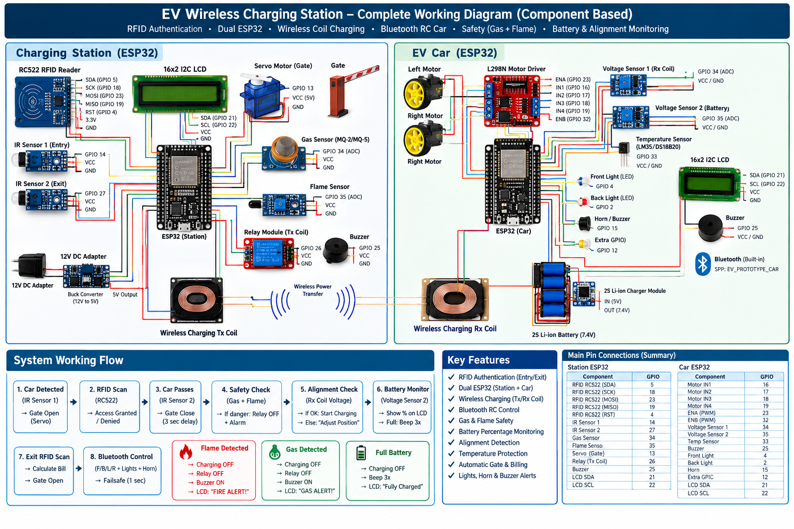
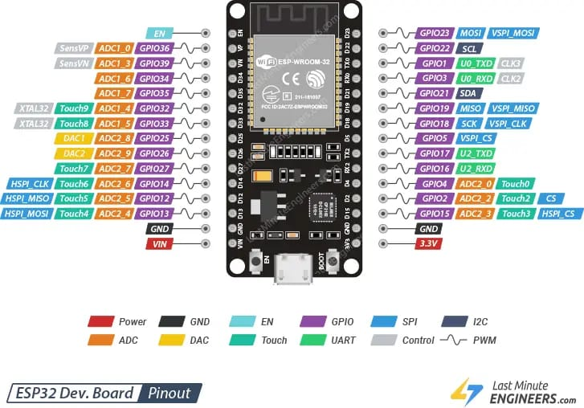
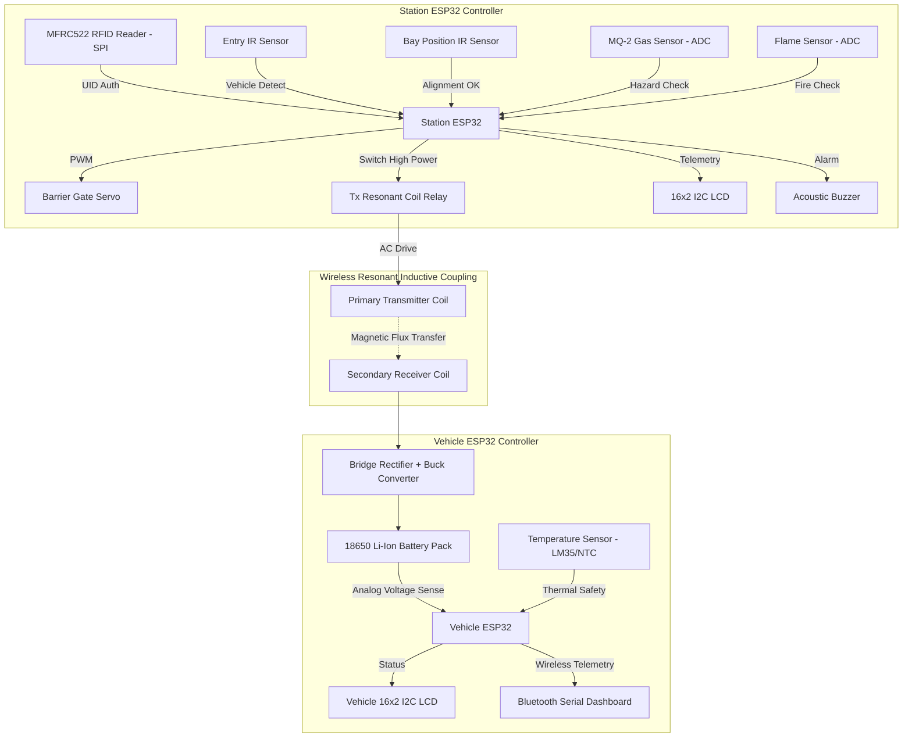

# Smart Wireless EV Charging System with RFID Authentication & Multi-Sensor Safety Cutoff

> **Major Engineering Project | Graphic Era Hill University (B.Tech ECE 2023–2027)**  
> **Author:** Parth Dalakoti (*President, Robotics & Automation Club, GEHU*)  
> **Contact:** `parthdalakoti482@gmail.com` | [LinkedIn](https://linkedin.com/in/parthdalakoti)

---

## ⚡ Executive Engineering Summary

This project implements an intelligent, safety-interlocked **Inductive Wireless Electric Vehicle (EV) Charging Station** engineered using a **Dual ESP32 Master-Vehicle Architecture**:
1. **Station Controller (ESP32 #1):** Governs user RFID authentication (RC522 via SPI), automatic motorized servo barrier gate access, high-power primary transmitter coil relay switching, and ambient gas/flame hazard monitoring.
2. **Vehicle Controller (ESP32 #2):** Monitors receiver coil rectification, battery terminal voltage via resistive divider scaling, cell temperature via analog thermistor, and transmits real-time telemetry over Bluetooth Serial to the user dashboard.
3. **Interactive Simulation:** Full virtual hardware prototype tested and verified on **Wokwi Simulation**.

---

## 📸 Media & Hardware Architecture

| System Schematic & Circuit | Hardware Components |
| :---: | :---: |
|  |  |

---

## ⚙️ System Architecture & Data Flow

---

## 🛠️ Bill of Materials (BOM)

| Component | Specification / Model | Operating Voltage | Interface | Function |
| :--- | :--- | :--- | :--- | :--- |
| **Microcontroller (x2)** | ESP32-WROOM-32 (Dual Core 240MHz) | 3.3V / 5V | SPI, I2C, ADC, UART | Main logic, telemetry & safety |
| **RFID Reader** | MFRC522 (13.56 MHz RFID) | 3.3V | Hardware SPI | Driver/Vehicle ID authentication |
| **Wireless Power Module** | Inductive Resonant Coil Pair (5V-12V, 2A) | 12V DC Input | Electromagnetic Induction | Wireless energy transfer |
| **Combustible Gas Sensor** | MQ-2 Semiconductor Gas Sensor | 5V | Analog ADC (Pin 34) | Gas leakage / smoke cutoff |
| **Flame Sensor** | IR Phototransistor Module | 5V | Analog ADC (Pin 35) | Spark and fire emergency trip |
| **Display (x2)** | 16x2 Character LCD with PCF8574 Backpack | 5V | I2C (Address 0x27) | Real-time voltage & status telemetry |
| **Barrier Gate Actuator** | SG90 9g Micro Servo | 5V | PWM (50Hz) | Physical bay entry gate |
| **Power Switch** | 5V Optocoupled Relay Module | 5V Coil | GPIO (Pin 26) | Primary transmitter coil activation |
| **Battery Storage** | 2S 18650 Lithium-Ion Battery (7.4V - 8.4V) | 7.4V Nominal | DC Terminals | On-board EV energy storage |

---

## 🔌 Hardware Pinout & Wiring Connections

### Station ESP32 Pin Mapping
* **MFRC522 RFID:** `SS = GPIO 5`, `RST = GPIO 4`, `SCK = GPIO 18`, `MOSI = GPIO 23`, `MISO = GPIO 19`
* **Sensors:** `IR1 = GPIO 14`, `IR2 = GPIO 27`, `MQ-2 = GPIO 34`, `Flame = GPIO 35`
* **Actuators:** `Relay = GPIO 26`, `Buzzer = GPIO 25`, `Servo = GPIO 13`
* **Display:** `I2C SDA = GPIO 21`, `I2C SCL = GPIO 22`

### Vehicle ESP32 Pin Mapping
* **Voltage Sensing:** `Divider 1 = GPIO 34`, `Divider 2 = GPIO 35`
* **Thermal Sensor:** `Temp = GPIO 33`
* **Lighting & Alerts:** `Front Light = GPIO 4`, `Back Light = GPIO 2`, `Buzzer = GPIO 25`
* **Display:** `I2C SDA = GPIO 21`, `I2C SCL = GPIO 22`

---

## 💻 Running the Simulation (Wokwi)

1. Open [Wokwi Simulator](https://wokwi.com/).
2. Load [`simulation/Station_ESP32/diagram.json`](simulation/Station_ESP32/diagram.json) and [`simulation/Station_ESP32/sketch.ino`](simulation/Station_ESP32/sketch.ino).
3. Click **Start Simulation**.
4. Swipe the virtual RFID card or press the IR sensor buttons to simulate vehicle arrival and trigger automatic inductive coil charging.

---

## 📑 Detailed Engineering Documentation
* Complete project report available at [`docs/EV_Wireless_Charging_Project_Report.pdf`](docs/EV_Wireless_Charging_Project_Report.pdf)
* Detailed hardware component guide at [`docs/EV_Component_Reference_Guide.pdf`](docs/EV_Component_Reference_Guide.pdf)

---

## 👨‍💻 Engineering Author
**Parth Dalakoti**  
*B.Tech in Electronics & Communication Engineering (2023–2027)*  
*Graphic Era Hill University (GEHU), Bhimtal Campus*  
*President, Robotics & Automation Club, GEHU*
